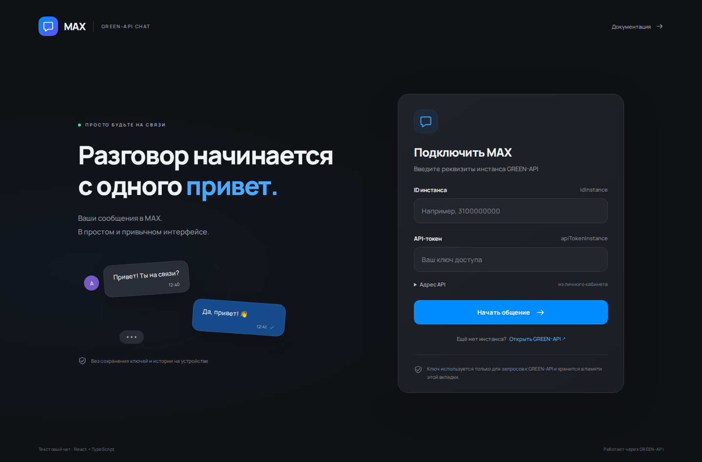
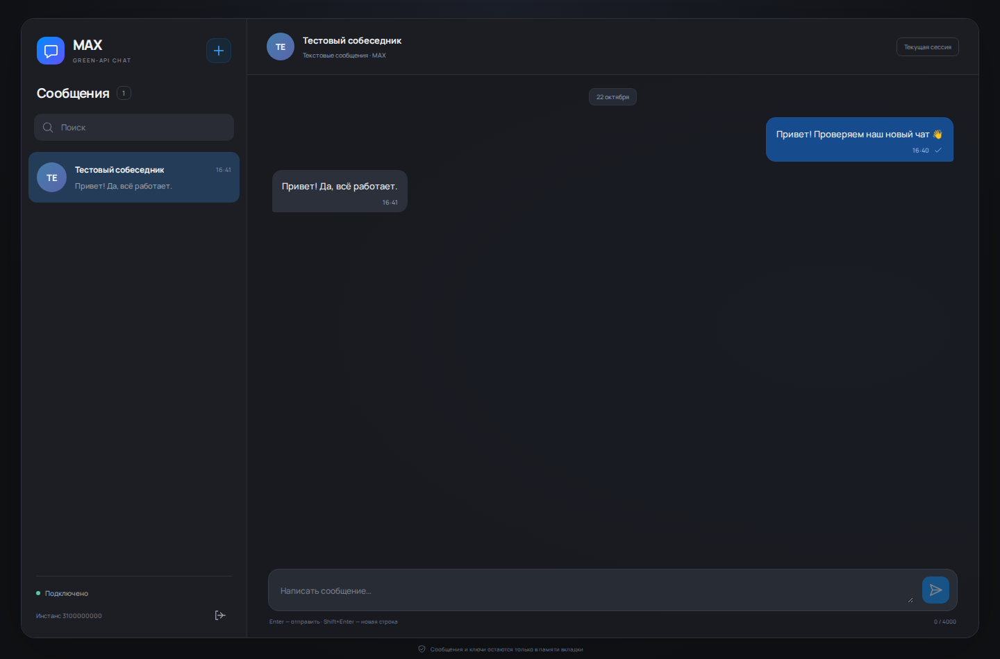
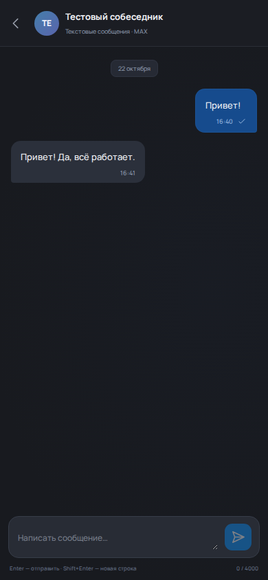

# MAX · GREEN-API Chat

Минимальный текстовый чат MAX на **React + TypeScript**, выполненный по [тестовому заданию GREEN-API](https://drive.google.com/file/d/1Ut39kkIs0QK-swnCsIPJc6pNqVIVGOD2/view).

Пользователь подключает свой инстанс, создаёт чат по номеру телефона, отправляет сообщение и видит ответ из MAX. Внешний вид и навигация вдохновлены веб-версией MAX. Все данные на иллюстрациях вымышлены; личные данные из MAX не использовались.







## Локальный запуск

Нужны **Node.js 22.12+** и npm. Рекомендуется актуальная LTS-версия Node.js 22.

```bash
git clone https://github.com/xane/test-green-api.git
cd test-green-api
npm ci
npm run dev
```

Откройте **http://127.0.0.1:5173**. Если порт занят, Vite напечатает другой адрес.

Для просмотра production-сборки:

```bash
npm run build
npm run preview
```

Откройте адрес, напечатанный в терминале (по умолчанию **http://127.0.0.1:4173**). Сервер приложения и база данных не нужны: запросы выполняются из браузера непосредственно к GREEN-API. Публикация на хостинг в эту работу не входит.

## Настройка GREEN-API

1. В [личном кабинете GREEN-API](https://console.green-api.com/) создайте инстанс **MAX** и авторизуйте его в соответствии с инструкциями сервиса. Вход в приложение не заменяет привязку MAX к инстансу.
2. Убедитесь, что состояние инстанса — `authorized`.
3. В настройках инстанса очистите **`webhookUrl`** и включите **«Получать уведомления о входящих сообщениях и файлах»** (`incomingWebhook: "yes"`). После сохранения подождите примерно минуту.
4. Скопируйте **`idInstance`**, **`apiTokenInstance`** и **`apiUrl`**. В форме входа раскройте «Адрес API» и укажите адрес именно своего инстанса. Значение по умолчанию — `https://3100.api.green-api.com`; другой кластер требует своего адреса. Допускается суффикс `/v3`.
5. Введите реквизиты и нажмите **«Начать общение»**. Приложение проверит состояние и настройки, но не будет изменять их.

Используйте отдельный тестовый инстанс. HTTP-получение подтверждает события методом `DeleteNotification`: после подтверждения событие удаляется из очереди GREEN-API. Не запускайте несколько клиентов получения для одного инстанса одновременно — они будут конкурировать за одну очередь.

Документация: [формат запросов](https://green-api.com/v3/docs/request-format/), [CheckAccount](https://green-api.com/v3/docs/api/service/CheckAccount/), [SendMessage](https://green-api.com/v3/docs/api/sending/SendMessage/), [HTTP-получение](https://green-api.com/v3/docs/api/receiving/technology-http-api/).

## Проверка с реальным MAX

1. Подготовьте авторизованный инстанс и второго собеседника с MAX.
2. Подключитесь в приложении и нажмите **«Новый чат»**. Введите телефон собеседника: Россия `+7` (11 цифр) или Беларусь `+375` (12 цифр). Российский префикс `8` преобразуется в `7`.
3. Отправьте текст и проверьте его получение на стороне собеседника.
4. Ответьте из MAX. Ответ должен появиться в том же чате приложения, без обновления страницы.
5. Проверьте переключение диалогов, счётчик непрочитанных, Enter / Shift+Enter и узкий экран.
6. Выйдите: приём и незавершённые запросы отменяются, реквизиты и история исчезают из интерфейса. После перезагрузки понадобится повторный вход.

Галочка означает **«принято GREEN-API»**, а не доставку или прочтение. При сетевой ошибке после отправки нельзя достоверно узнать, принял ли её сервер: текст остаётся в поле, сообщение помечается как неподтверждённое. Автоматической повторной отправки нет; перед ручным повтором проверьте MAX.

## Проверки

```bash
npm run typecheck
npm run lint
npm test
npm run build
```

Браузерные сценарии:

```bash
npx playwright install chromium
npm run test:e2e
```

На Linux при отсутствии системных библиотек используйте `npx playwright install --with-deps chromium`. Playwright сам поднимает локальный Vite-сервер. Скриншоты в `docs/` воспроизводятся браузерными сценариями.

- Vitest / React Testing Library проверяют API-контракты, вход, создание чата, отправку, получение, сохранение черновика, отмену запросов, повторные уведомления и восстановление связи.
- Playwright проверяет полный сценарий переписки на компьютере, сетевую ошибку, мобильную навигацию, многострочный ввод и очистку сессии.
- Запросы GREEN-API во всех автоматических сценариях **подменяются**. Действительные токены не нужны; внешние сообщения не отправляются.
- CI запускает статические проверки, тесты и сборку, затем браузерные сценарии.

**Реальная отправка и получение через MAX автором автоматических проверок не выполнялись.** Живая проверка остаётся пользователю по сценарию выше. Зелёные тесты с подменённым API не являются подтверждением работы конкретного инстанса.

## Архитектура и решения

- `src/api.ts` — типизированный клиент на `fetch`, проверка реквизитов и ответов, таймауты, отмена через `AbortSignal`. Разрешены только HTTPS-хосты GREEN-API; исходные сетевые ошибки и URL с токеном не попадают в пользовательские сообщения.
- `src/notifications.ts` — один последовательный long-polling-цикл на подключение: `ReceiveNotification` → обработка → `DeleteNotification`. Пустой ответ не считается ошибкой; временные сбои повторяются с задержкой 1–30 секунд. HTTP 401/403 останавливают приём. Неподдерживаемые события подтверждаются и пропускаются, чтобы не блокировать очередь.
- React Context + `useReducer` хранят диалоги, сообщения, черновики, активный чат и состояние соединения. Повторная доставка с тем же `chatId` / `idMessage` не создаёт копию сообщения.
- `CheckAccount` преобразует телефон в канонический `chatId`, поэтому исходящие сообщения и ответы относятся к одному диалогу.
- Состояние не сохраняется в `localStorage`, `sessionStorage`, cookies или БД. Токен вводится пользователем, передаётся только GREEN-API и остаётся в памяти страницы до выхода/закрытия. GREEN-API требует токен в URL запроса, поэтому он виден в DevTools владельцу браузера; это не серверное хранилище секретов.
- Шрифт включён в сборку. Сторонние аналитические сервисы, удалённые аватары и внешние шрифтовые запросы отсутствуют.

## Границы задания

Поддерживаются личные чаты и входящие `textMessage` / `extendedTextMessage` (включая текст со ссылкой). Медиа, группы, импорт старой истории, синхронизация отправленных из других клиентов сообщений, статусы доставки/прочтения, редактирование и удаление сообщений не реализованы. Уведомления этих типов пропускаются.

После перезагрузки прежняя история текущей вкладки недоступна. Обработка уведомления и его удаление из внешней очереди не являются одной транзакцией: закрытие страницы между этими действиями может привести к повторной доставке; защита от дублей работает в рамках открытой сессии.
